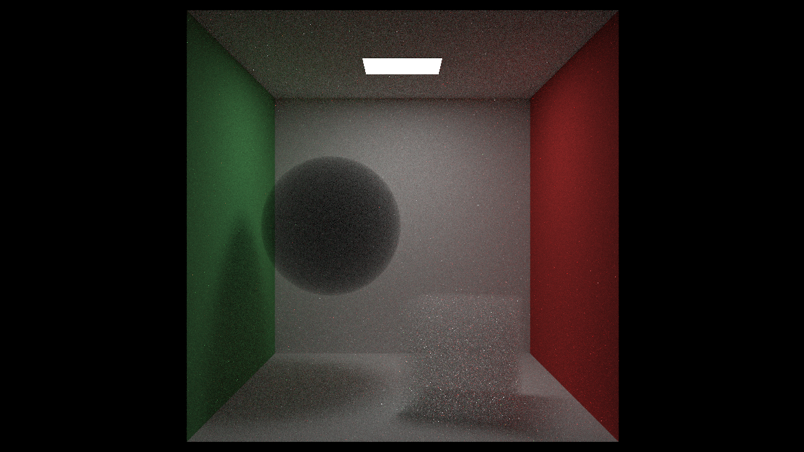

# BOX surfaces and fog boundaries

`BOX` is now an analytic primitive. The Fog Test uses the user's black spherical medium and white box medium at density 0.01. A medium samples scattering inside its closed boundary; six independent planar media cannot represent that volume.

Box transforms are prepared on the CPU as a world center, half sizes and orthonormal axes in the separate `Boxes` GPU field. Only box index and boundary kind are added to the shared object record. BVH bounds are the extrema of the eight transformed corners. Local-space slab intersections preserve world ray parameter t and physical path length, and produce face normals/UV matching the former quad surfaces. Closed box lights retain the existing quad-mixture PDF through six sampling targets.

All preset box generators have been replaced. Legacy spherical media normalize to the same prepared records as explicit sphere boundaries. The nested boundary is not inserted into the visible scene. Scene/box/light capacities are validated before any upload.

## Validation

CPU checks cover preparation, transforms, positive dimensions, raw BVH diagnostics, sphere compatibility, one-leaf geometry and expanded light capacities. GPU checks compare 13 rays against independent six-quad geometry, including interior exits, all face UVs/normals and misses. Additional checks cover parallel/edge rays, zero directions, finite distance limits, box-light PDFs, and 8192-sample medium distributions with normalized/scaled rays, interior origins and clipped intervals. Expected probability is `1-exp(-density*distance)`; rotated-box misses produce no scattering. Successful scattering records are checked for distance, world position, material, normal and UV values.

Full integration covers all nine presets in fused/separate modes, reloads, capacity rejection, native GUI recovery and 2000/10000-object stress scenes. Final validation: 22 CPU tests, 110 hardware/browser checks and ESLint all pass. [Hardware results](box-medium/validation.json) include the source fingerprint. Independent review found a false BOX surface hit at the finite distance limit; the hardware regression failed before the correction and passed afterward.

## Limits

Boundaries are spheres or rigidly rotated/transformed boxes. Arbitrary quad volumes and scaling are future work. Float32 precision, the existing surface epsilon and finite ray-distance bound remain unchanged. Historical performance-review artifacts describe the earlier implementation; current BOX results are a separate dataset.

## Recorded performance

Intel hardware WebGPU (gen-12lp), Chrome 154, 1200 x 675. Sequential runs: five warmup samples, then fifty measured completed samples. Camera, density, depth and seed match on the four comparable presets. Full frame latency includes GPU synchronization and presentation; it is not animation-loop FPS.

| Scene | Before median ms | BOX median ms | Reduction | Before / BOX p95 ms |
| --- | ---: | ---: | ---: | ---: |
| Test Scene | 52.3 | 39.2 | 25.0% | 63.3 / 43.9 |
| Bouncing Spheres | 383.1 | 359.2 | 6.2% | 404.9 / 393.5 |
| Cornell Box | 75.2 | 46.4 | 38.3% | 88.3 / 51.1 |
| Cornell Glass | 162.1 | 112.1 | 30.8% | 173.6 / 120.2 |

No median regression exceeds 5% in these runs. Power state and compiler caches affect exact timings. [Raw baseline](box-medium/before.json) and [BOX data](box-medium/after.json) include all samples and source fingerprints. Both runs were captured from dirty checkouts based on c1f8afe; fingerprints identify the actual implementations.

Fog Test median: 46.5 ms. Its previous six-medium boundary could not render, so no speed ratio is claimed. The screenshot contains 55 accumulated samples, including warmup.

